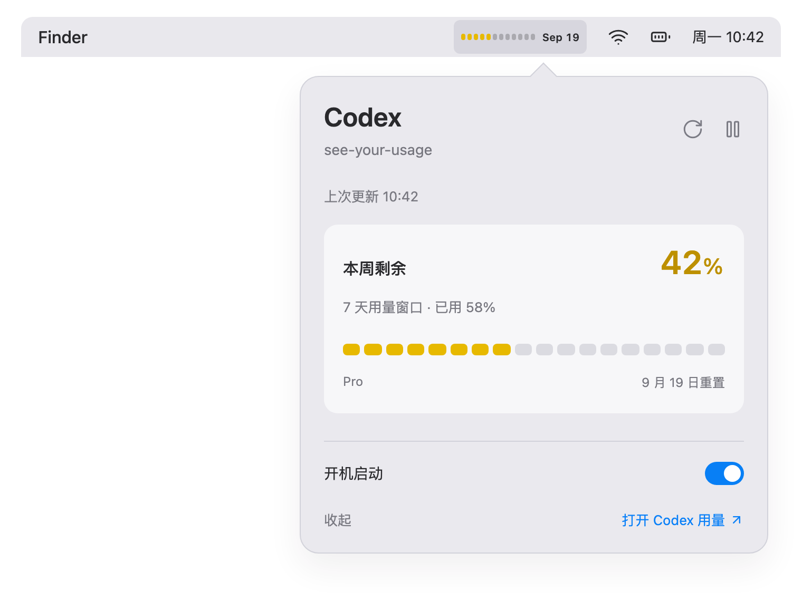
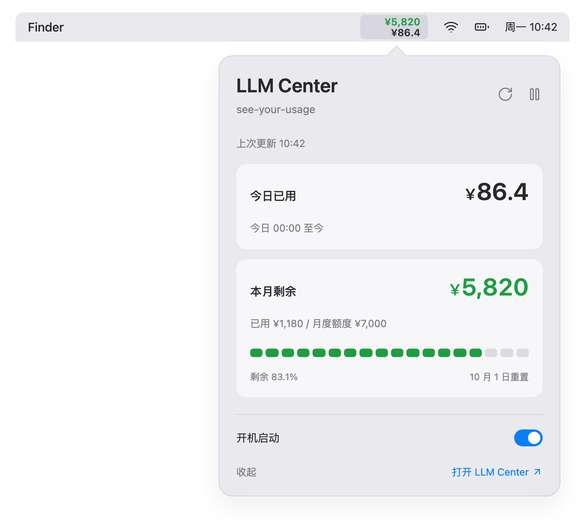

# see-your-usage

A native, low-energy macOS menu bar app for Codex and an optional LLM Center.
The two services are displayed and refreshed independently in one process.

## Preview

Product illustrations with example data and simplified controls.





## Menu bar

- **Codex** keeps its segmented remaining-capacity bars and reset dates. Menu width
  follows the date text, with no window labels or refresh dot. Weekly-only responses
  use one row; full window names remain in the popover.
- **LLM Center** uses two unlabeled rows: the selected Key’s remaining amount above,
  today's spending below. Width follows the text instead of reserving a wide slot.
- Money uses `¥`: monthly amounts are integers and today's spending has one decimal,
  truncated rather than rounded. Actual zero spending today
  displays `Nah`. Large menu values use `万`; the popover shows the full integer.
- Use **个人 Key / 项目 Key** in the popover to switch both menu values. The app
  defaults to project usage and remembers the selection. If multiple projects are
  available, select one in the popover.
- Personal remaining amounts below 300 are red, 300–599.99 yellow, and 600 or more
  green. Project balances use 3,000 and 6,000 as the corresponding boundaries.
  Codex's percentage thresholds are unchanged.

In the expanded LLM Center popover, today's usage is shown above the selected Key's remaining amount. Personal quota
resets monthly; project mode shows your Key's available credit. In a member-based project,
spending and allowance belong to your account; shared project keys use project totals.

## Independent service settings

Each popover has **启动并在菜单栏显示** and **开机启动此服务** switches.
Hiding a service stops its timers, requests and authorization polling. The other
service continues normally. Login startup preferences are independent; a manual
launch can still display a service whose login startup is off.

Use **服务…** in either popover to restore a hidden service. If both are hidden,
reopen `see-your-usage` from Spotlight or Applications to access these switches.
macOS lists one login item for the app; it runs the services enabled for login.

## LLM Center setup

LLM Center is an optional integration for ModelBest's internal API-key and budget
platform. It requires authorized company-network access. The implementation reads
personal and selected-project quota data; it does not use inference API keys or perform model calls. Project-detail responses
include member key fields; the app ignores those fields and decodes only quota data.

LLM Center connects directly through the company network, including its separate
identity service used for token renewal. These requests do not use the macOS
system forward proxy. Codex continues to use the system proxy. HTTPS certificate
validation remains enabled for both services.

In its popover, choose **平台地址…** and enter the HTTPS root URL supplied by your
organization. The hostname is stored only in local app preferences, not in this
repository. An unconfigured installation makes no requests to an internal platform.

On launch, configured instances try saved credentials without opening a browser.
Choose **在 Safari 中登录** when authorization is needed. The app opens the
platform's official OIDC authorization page in Safari and uses PKCE (S256).
The platform relays a one-time authorization code; the app exchanges it using its
locally generated verifier. It does not read browser cookies or credentials.
No CLI installation or Safari Automation permission is needed for the new flow.
Ordinary network failures show **未更新 / LLM Center** without a sign-in button.

Access and refresh tokens are stored together in macOS Keychain, separated by
platform origin. New PKCE sessions use a separate account namespace from older
logins, without deleting old entries or changing their access controls. A newly
issued token is validated with a quota request before replacing the saved session.
The app renews natively when less than a minute remains, or retries once after an
authentication rejection. Rotated credentials are saved before another quota
request. Safari can be closed after login. An expired refresh grant requires a
new explicit login; outages retain the session and back off.

Authorization metadata comes from the configured HTTPS platform. The authorization
and token endpoints must share an HTTPS origin, and the callback must return to
the configured platform. State, client ID, callback and the S256 challenge are
validated before opening Safari or exchanging the code. Requests reject redirects.
The protocol version tag required by the platform identifies compatibility with
llmctl 0.2.15; the app does not execute that CLI.

Older servers and saved web-token sessions retain the original device flow. Only
that legacy recovery path uses a temporary background Safari tab and previously
granted Automation permission. It never selects tabs, activates Safari, creates
windows or asks for permission in the background. Recovery is bounded to 45 seconds
plus any request already in flight, and cleans up only an unselected tab still
matching the attempt's unique URL.

Changing the platform address cancels existing requests and requires that origin's
login. Keychain operations prohibit system authentication prompts, including legacy
login-keychain ACL dialogs. Tokens are cached in memory; denied access stops retrying.
If a fresh login cannot be persisted, the app uses it in memory and explains that
restart will require another login. It never changes keychain access controls or
falls back to plaintext token files.

## Energy and freshness

- AppKit; no Electron, embedded browser, telemetry or CLI subprocess. Safari is
  opened only for a user-requested login; the app does not keep a web view running.
- Personal mode uses one read-only quota request per refresh. Project mode reads
  the project list and today’s statistics. Member-based projects also read the current
  account, member allowance and available credit (five requests for a single list page),
  with token renewal when needed;
  no log scanning or cost estimation.
- One coalescible, one-shot timer per running service: 5 minutes normally,
  10 minutes in Low Power Mode. No high-frequency UI timers or animation loops.
- Popover refreshes are deduplicated and throttled. Failures back off through
  5, 10, 20, 40, then 60 minutes. Manual refresh is throttled to 5 seconds.
- Pause, sleep or disabling the service cancels its work. Missing login/configuration
  stops periodic refresh. Wake schedules a delayed refresh instead of a burst.
- Beijing day/month boundaries invalidate old values when the display updates;
  last known data remains inside the popover with its timestamp and error.
- Interactive login follows the server's expiry, capped at ten minutes. Native
  renewal requests are deduplicated and add no
  periodic timer. An in-flight rotating grant finishes saving its result even if
  the associated quota refresh is cancelled.

## Build and install

Requires macOS 14+ and Xcode Command Line Tools. Apple Silicon and Intel supported.

```sh
./scripts/run.sh
./scripts/build_app.sh
swift test
```

`run.sh` installs to `~/Applications/see-your-usage.app`. For native light/dark
layout snapshots using synthetic test fixtures:

```sh
SEE_USAGE_QA_DIR="$PWD/.build/qa" swift test
```

The README illustrations are drawn in
[HTML/CSS](docs/design/product-previews.html). To regenerate the separate native
UI captures from synthetic state:

```sh
SEE_USAGE_PRODUCT_DIR="$PWD/docs/images" swift test --filter renderProductScreenshots
```

Review [SECURITY.md](SECURITY.md) before publishing diagnostics or screenshots.

## License

MIT
